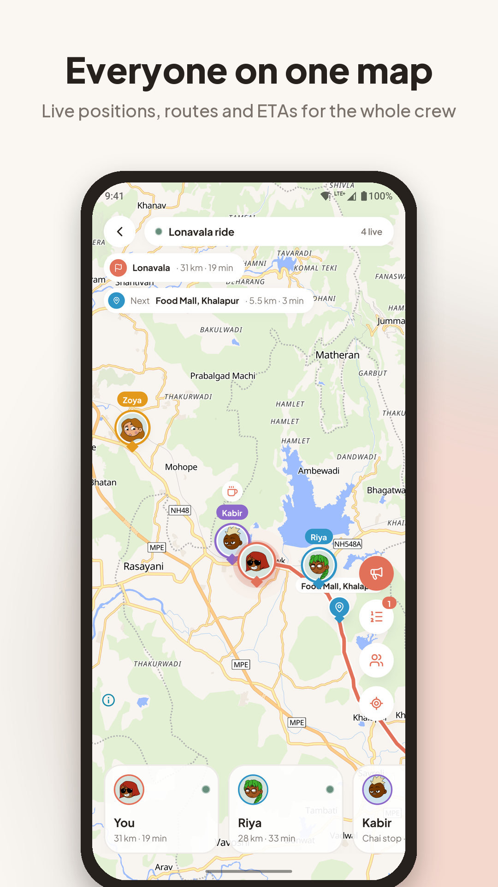
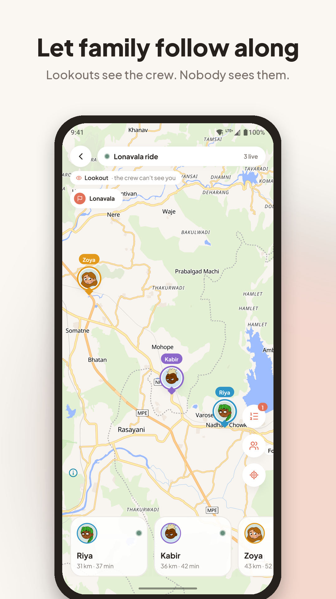
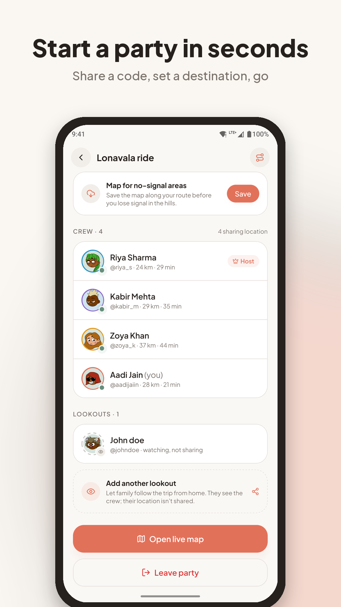
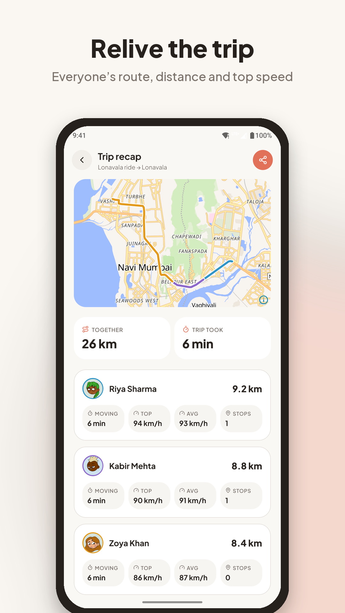
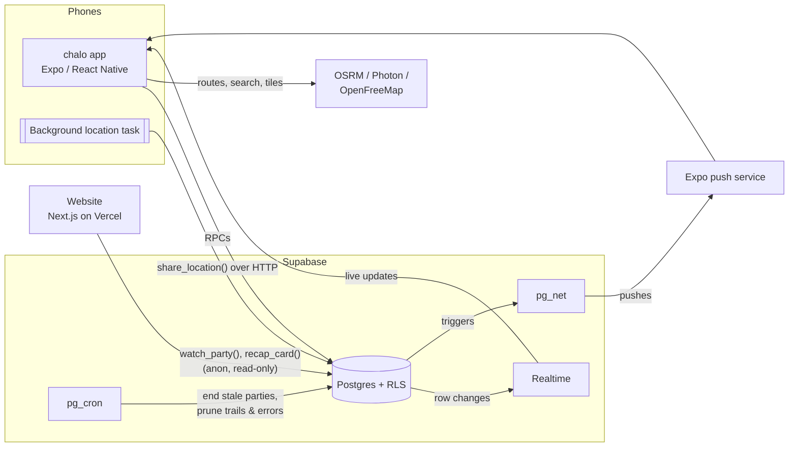

<p align="center">
  
</p>

<h1 align="center">chalo</h1>

<p align="center">
  <strong>Live location for your crew, on one map.</strong><br />
  Start a party and everyone in it shows up on one live map, with their own avatar, route and ETA.<br />
  Built for road trips, group rides, treks and everyone waiting at home.
</p>

<p align="center">
  <a href="https://chalo.aadijain.dev">Website</a> ·
  <a href="https://chalo.aadijain.dev/download">Download for Android</a> ·
  <a href="https://github.com/aadijaiin/chalo/releases/latest">Latest release</a> ·
  <a href="https://chalo.aadijain.dev/privacy">Privacy</a>
</p>

<p align="center">
  
  
  
  
</p>

---

## Contents

- [What it does](#what-it-does)
- [How it works](#how-it-works)
- [Privacy model](#privacy-model)
- [Repository layout](#repository-layout)
- [Tech stack](#tech-stack)
- [Getting started](#getting-started)
- [Day-to-day development](#day-to-day-development)
- [Testing and CI](#testing-and-ci)
- [Releasing](#releasing)
- [Operations](#operations)
- [Configuration reference](#configuration-reference)
- [Troubleshooting](#troubleshooting)

## What it does

**Parties.** The host starts a party and gets a six-character code (no look-alike characters: no
`0/O`, `1/I/L`). Friends join with the code or an invite link (`chalo.aadijain.dev/j/CODE`), and
everyone shows up on one live map. You're in at most one live party at a time; parties end when
the host ends them, after 24 hours, or after 2 hours with nobody sharing.

**On the road**
- **Destination, stops and ETAs.** The host sets where you're headed; stops dropped on the map become
  waypoints. Each phone routes itself (OSRM) and posts its own ETA and distance left, so ETAs keep
  coming from locked phones.
- **Pings.** One tap for chai, fuel, food or wait up, or your own words. They show as a status on your
  avatar and push to everyone.
- **SOS.** Hold to send (a tap won't). It stays up until you, or the host, clear it.
- **Fell behind.** If someone drops 5 km further behind the lead than when they started, the crew
  hears about it; it clears under 3 km.
- **Battery and signal.** Everyone's battery level, and a hint when someone has probably just lost
  signal rather than ignoring you.
- **Offline maps.** Save the map along your route before the ghats.
- **Recap.** When it's over: everyone's route, distance, top speed and stops, and a shareable card.

**For the folks at home**
- **Lookouts.** Someone (a parent) can follow the trip without being on it. They ask, the host lets
  them in, and from then on they see the crew live and get SOS, arrival, "almost there" and
  fell-behind alerts. They never share a location, and the crew always sees who's watching.
- **Hide from lookouts.** Anyone in the crew can hide themselves from lookouts and watch links.
- **Watch links.** The host can share a browser link (`/w/<token>`) that shows the crew live, with
  alerts, until the trip ends. No app or account needed; the host can turn it off.

**Control**
- The host can remove anyone; a removed person stops sharing at once and can't rejoin.
- Accounts can be deleted from the app or the website.

## How it works



- **No servers of our own.** The backend is a Supabase project: Postgres, Auth, Realtime, `pg_cron`
  and `pg_net`. Every write goes through `security definer` RPCs that enforce the rules; tables are
  read-only to clients and guarded by row-level security.
- **Positions over HTTP, updates over Realtime.** Phones post their latest fix with
  `share_location()`, which works from a backgrounded phone, keeps only each member's latest
  position (overwritten in place), drops near-duplicate writes, and returns the party's current
  destination and stops so a locked phone keeps its route in step. Everyone else gets the change
  through Realtime `postgres_changes`.
- **Background sharing.** With "Allow all the time", an OS location task (an Android foreground
  service with a notification, an iOS background session) keeps posting while the phone is locked.
  GPS drops to network accuracy when you've been parked for two minutes.
- **Pushes straight from Postgres.** Triggers call Expo's push API through `pg_net` for pings, SOS,
  joins, arrivals, fell-behind, lookout requests and the party ending. No Edge Functions to deploy.
- **Housekeeping on a schedule.** `pg_cron` ends stale parties every 5 minutes and prunes recap
  trails and error reports after 30 days.

## Privacy model

Location is the whole product, so the rules live in the database, not the app.

| Who | Sees live positions | Shares their own | Gets pushes |
| --- | --- | --- | --- |
| Crew (in the party) | Everyone in the crew | Yes | Everything |
| Lookout, waiting for the host | Nobody, no statuses or pins | Never | None |
| Lookout, let in | The crew, except anyone hidden from lookouts | Never | SOS, arrived, almost there, fell behind, ended |
| Watch link (anyone with it) | Same as an approved lookout | — | — (browser notifications while open) |
| Someone who left or was removed | Nobody | No (the phone is told to stop) | None |
| Everyone else | Nobody | — | — |

- Positions are deleted when you leave or the party ends. Recap trails are kept 30 days and only
  for past members; recap cards and watch links never include account ids.
- `backend/tests/access.test.mjs` checks every row of this table against the real project (see
  [Testing](#testing-and-ci)).
- The app asks for "Allow all the time" only after an in-app explanation (Google Play's prominent
  disclosure). The website uses cookieless Vercel Web Analytics; the app has no analytics.

## Repository layout

| Folder | What | Stack |
| --- | --- | --- |
| [`app/`](app) | The product: the Android and iOS app | Expo SDK 58, React Native 0.88, expo-router, MapLibre, NativeWind |
| [`backend/`](backend) | Database schema, RLS, RPCs, triggers, migrations, privacy tests | Supabase (Postgres) |
| [`web/`](web) | Website, invite links (`/j`), watch links (`/w`), recap cards (`/r`), download, legal pages | Next.js 16, Tailwind 4, Motion, MapLibre GL |
| [`store/`](store) | Google Play graphics (generated) and [the publishing guide](store/PLAY_STORE.md) | Python + Pillow |
| [`.github/workflows`](.github/workflows) | CI and the Supabase keep-alive | GitHub Actions |

Each folder has its own README with more detail: [app](app/README.md), [backend](backend/README.md),
[web](web/README.md).

## Tech stack

Everything runs on free, open-source, or no-card free tiers.

| Concern | Choice |
| --- | --- |
| App framework | Expo (development builds, EAS Build), expo-router |
| UI | React Native Reusables (shadcn for RN) + NativeWind, Reanimated, Plus Jakarta Sans |
| Maps | MapLibre Native in the app, MapLibre GL on the web, [OpenFreeMap](https://openfreemap.org) tiles (no key) |
| Routing / search | Public OSRM server / Photon (komoot) |
| Avatars | DiceBear, generated on device (and on the server for the website) |
| Backend | Supabase: Postgres + RLS, Auth, Realtime, pg_cron, pg_net |
| Push | Expo push service (FCM on Android) |
| Website | Next.js App Router on Vercel, Tailwind CSS 4, Motion, Lenis |

## Getting started

You need Node 20+, [Bun](https://bun.sh) for the website, and the
[Supabase CLI](https://supabase.com/docs/guides/cli) for the backend. Android Studio and Xcode
are optional (builds can run in Expo's cloud).

### 1. Backend

1. Create a free project at [supabase.com/dashboard](https://supabase.com/dashboard).
2. Apply the migrations:
   ```bash
   cd backend
   supabase login
   supabase link --project-ref <your-project-ref>
   supabase db push --linked
   ```
3. While developing, turn off *Authentication → Sign In / Providers → Email → Confirm email*
   (the free mailer only sends a few emails an hour; the app handles both modes).

### 2. App

MapLibre is a native module, so Expo Go won't work: you need a development build, once.

```bash
cd app
cp .env.example .env        # paste the project URL, publishable key, and the site URL
npm install
npx eas-cli login && npx eas-cli init     # first time only
npm run build:android       # cloud build, ~15 min; install the APK on your phone
npm start                   # then open the installed app; JS changes hot-reload
```

With Android Studio installed, `npm run android` builds locally instead; with Xcode,
`npm run ios` runs the iOS simulator.

### 3. Website

```bash
cd web
cp .env.example .env.local   # or create it: see Configuration reference
bun install
bun run dev                  # http://localhost:3000
```

## Day-to-day development

- **Only rebuild the app when native code changes** (a new native package or a config plugin).
  Otherwise `npm start` and hot reload are enough.
- **Testing a party with two people:** run the iOS simulator next to your phone, signed in as a
  second account, and move the simulator with
  `xcrun simctl location booted start --speed=14 <lat,lng> <lat,lng>`. See
  [app/README.md](app/README.md#testing-a-party-with-two-people).
- **Database changes** go in a new file in `backend/supabase/migrations/` (never edit an applied
  one), then `supabase db push --linked`, then `node --test backend/tests/*.test.mjs`.
- **Commits** are small and layered (backend, then app, then web), in the
  `feat(app): …` / `fix(web): …` style you'll see in the history.

## Testing and CI

```bash
node --test backend/tests/*.test.mjs   # privacy tests against the linked project
cd app && npm run typecheck
cd web && bun run lint && bun run build
```

The privacy tests sign up throwaway accounts, play out a party (crew, lookout, outsider, a removed
rider), check who can see what at each step, and delete the accounts afterwards. They read the
project URL and key from `app/.env`, or `SUPABASE_URL` / `SUPABASE_KEY`.

[`ci.yml`](.github/workflows/ci.yml) runs the app typecheck and the website lint and build on pushes
to `main` and on pull requests, and the privacy tests on `main` (using the `SUPABASE_URL` and
`SUPABASE_KEY` repository secrets).

## Releasing

### Android APK (from the website)

Until chalo is on the Play Store, people download the APK from
[chalo.aadijain.dev/download](https://chalo.aadijain.dev/download), which links the newest GitHub
release's `chalo.apk`.

1. Bump `version` in `app/app.json` (the build number increments by itself).
2. `cd app && npm run build:apk` (64-bit ARM, signed with the project's EAS key, so it installs over
   older versions and keeps people signed in).
3. Publish a GitHub release tagged `vX.Y.Z` with the file attached as **`chalo.apk`**.
4. Bump `version` (and `notes`, `size`) in `web/public/download/latest.json` and push. Installed
   apps check it and offer the update on their home screen.

### Google Play

Everything is prepared: `npm run build:play` builds the app bundle, `npm run submit:play` uploads
it, and [store/PLAY_STORE.md](store/PLAY_STORE.md) walks through the console, the data-safety
answers, the background-location declaration and the closed-testing requirement.

### iOS

The app runs on iOS (simulator via `npm run ios`), but publishing needs an Apple Developer account.
iPhone users can follow trips through watch links meanwhile.

## Operations

| What | Where |
| --- | --- |
| Crash and error reports from the app | `app_errors` table (Supabase Table Editor), kept 30 days |
| Keeping the free Supabase project awake | [`keepalive.yml`](.github/workflows/keepalive.yml), daily; a failure emails you. GitHub pauses scheduled workflows after 60 days without commits: re-enable from the Actions tab |
| Website visits | Vercel → chalo → Analytics |
| Stale parties, old trails and errors | `pg_cron` jobs in the database |
| Website deploys | Automatic from `main` (Vercel); every branch gets a preview URL |

## Configuration reference

**App** (`app/.env`, and the `preview` / `production` profiles in `app/eas.json` for cloud builds,
which never see `.env`)

| Variable | What |
| --- | --- |
| `EXPO_PUBLIC_SUPABASE_URL` | The Supabase project URL |
| `EXPO_PUBLIC_SUPABASE_KEY` | The project's **publishable** key (never the service role key) |
| `EXPO_PUBLIC_SITE_URL` | The website, for invite, watch and recap links |

**Website** (`web/.env.local`, and Vercel project settings)

| Variable | What |
| --- | --- |
| `NEXT_PUBLIC_SUPABASE_URL`, `NEXT_PUBLIC_SUPABASE_KEY` | Same project and publishable key |
| `NEXT_PUBLIC_CONTACT_EMAIL` | Shown on the privacy, terms and delete-account pages |
| `NEXT_PUBLIC_APK_URL` | Optional; defaults to the latest GitHub release's `chalo.apk` |
| `NEXT_PUBLIC_PLAY_STORE_URL`, `NEXT_PUBLIC_APP_STORE_URL` | Optional; store buttons appear when set |

**Repository secrets** (GitHub): `SUPABASE_URL` and `SUPABASE_KEY` for CI and the keep-alive.

## Troubleshooting

| Symptom | Fix |
| --- | --- |
| The app opens Expo's launcher instead of chalo | It's a development build: start Metro (`npm start`) and pick the server |
| `column … does not exist` right after a migration | Supabase's API caches the schema for a moment; retry after a few seconds |
| Nobody sees me when my phone is locked | Location must be "Allow all the time"; the lobby has a one-tap fix |
| No push notifications on an Android emulator | Emulators have no FCM; use a real phone |
| `aps-environment` warning on the iOS simulator | The local `ios/` folder is old: `npx expo prebuild -p ios` |
| The website download button gives a 404 | No published GitHub release has a `chalo.apk` asset |
| The map is blank on the watch page | The browser needs WebGL; the crew list still works without it |
